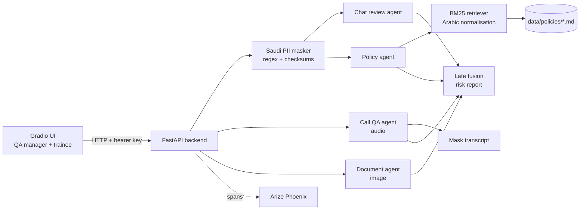

# Contact-Center QA Copilot

Arabic-first, multimodal quality assurance and data-protection review for customer service teams,
built for a fictional Saudi telecom operator, **Rimal Telecom**.

Saudi contact centers handle millions of chats and calls in Najdi, Hijazi and Gulf dialects, often mixed
with English. QA teams can only listen to a small sample, and personal data (national IDs, Iqama numbers,
IBANs) regularly ends up in transcripts. This project reviews every interaction automatically:

- **Chat review**: tone, professionalism, missed escalations and promises the agent cannot keep, judged by the norms of the dialect used
- **Call QA**: transcribes a call in its original dialect, separates agent and customer turns, and scores the agent on a 5-point rubric
- **Document review**: classifies photos customers send (ID cards, bank cards, invoices) and flags which must be deleted
- **Policy compliance (RAG)**: retrieves the relevant company policy and checks the agent's reply against it, with a compliant rewrite
- **Saudi PII masking**: national ID / Iqama (with checksum), SA IBAN (mod-97), Saudi mobiles and emails, including Arabic-Indic digits, masked **before** anything is sent to an LLM
- **Training simulator**: an LLM plays an angry customer in the dialect you choose, and every trainee reply is reviewed before the customer sees it

It extends my earlier [Multimodal Customer Service Trainer](https://github.com/yaraxxx/Multimodal-Customer-Service-Trainer)
(per-modality Gemini agents, late fusion, pydantic-evals, Phoenix tracing) with Arabic NLP, RAG, privacy-by-design and deployment.

> ملخص بالعربية: مساعد ذكي لمراكز خدمة العملاء في السعودية، يراجع المحادثات والمكالمات باللهجات السعودية
> (النجدية والحجازية والخليجية)، ويقيّم أداء الموظف، ويتحقق من الالتزام بسياسات الشركة، ويخفي البيانات الشخصية
> مثل رقم الهوية والإقامة والآيبان قبل إرسال أي نص إلى نموذج الذكاء الاصطناعي، تماشياً مع مبادئ نظام حماية البيانات الشخصية.

## Architecture



Every agent is a `pydantic_ai.Agent` with a typed Pydantic output (`cc_copilot/types/results.py`).
`cc_copilot/fusion.py` combines the per-modality results into one report: `high` risk if anything is blocking
(PII exposed, policy violated, escalation missed), `medium` for warnings (tone, low QA score), otherwise `low`.

## Privacy by design (PDPL)

These are engineering choices inspired by the principles of Saudi Arabia's Personal Data Protection Law. They are not legal advice.

| Principle | How the code applies it |
|---|---|
| Data minimisation | `pii/saudi_patterns.py` masks IDs, IBANs, phones and emails before text reaches the model provider. A test (`tests/test_agents.py`) asserts the raw ID never appears in the prompt. |
| No raw values in outputs | API responses return PII *positions and types*, never the values. Phoenix traces only contain masked prompts. |
| Grounded decisions | The policy agent may only cite policy IDs it was given; hallucinated citations are dropped in code. |
| Retention | The document agent flags identity documents that must be deleted after verification (policy IDV-3). |
| Known gap: audio | Audio cannot be masked before transcription, so call recordings reach the provider. For production, use a model hosted in a KSA cloud region or a self-hosted Arabic speech model. See the roadmap. |

## Quickstart

```bash
uv sync
cp .env.example .env        # add your own Gemini key from https://aistudio.google.com/apikey
uv run pytest               # 33 offline tests, no API key needed
uv run python evals/pii_detector_eval.py   # offline PII precision/recall

uv run cc-copilot           # Phoenix (6006) + API (8000) + UI (7860)
```

Or run only the API in Docker: `docker build -t cc-copilot . && docker run -p 8000:8000 --env-file .env cc-copilot`.

### API

All endpoints need `Authorization: Bearer $USER_API_KEY`.

| Endpoint | Needs Gemini | Purpose |
|---|---|---|
| `POST /api/v1/pii/mask` | No | Mask Saudi PII in text |
| `POST /api/v1/review/chat` | Yes | Review a `Customer:` / `Agent:` transcript |
| `POST /api/v1/review/call` | Yes | QA-score an audio recording |
| `POST /api/v1/review/document` | Yes | Classify a customer image |
| `POST /api/v1/policy/check` | Yes | Check an agent reply against policy (RAG) |
| `GET /api/v1/health` | No | Health check |

LLM endpoints return `503` with a clear message if Gemini is not configured.

## Evaluation

| Eval | Command | What it measures |
|---|---|---|
| PII detector | `uv run python evals/pii_detector_eval.py` | Precision/recall per PII type across dialects, offline |
| Chat review | `uv run python evals/chat_review_eval.py` | Flag accuracy + LLM-judged rationale, per dialect (`pydantic-evals`) |

Datasets live in `evals/datasets/*.jsonl`, and every case is labelled with its dialect. All personal numbers in them
are synthetic values that pass the checksum but belong to no one.

## Project layout

```
cc_copilot/
  agents/        chat_review, call_qa, document, policy (RAG), customer_sim
  pii/           Saudi PII detection + masking
  rag/           Arabic normalisation + BM25 policy retriever
  types/         Pydantic result schemas
  fusion.py      late fusion into a risk report
  api.py         FastAPI backend
  gradio_app.py  UI: PII masker, chat review, call QA, policy check, training simulator
data/policies/   bilingual sample policies (fictional)
evals/           datasets + eval scripts
tests/           offline tests (pydantic-ai TestModel, no network)
```

## Roadmap

Each milestone adds a skill that Saudi AI job postings ask for. Tick them off and record results in this README.

- [x] **M0 Scaffold**: agents, Saudi PII masking, BM25 RAG, FastAPI, Gradio, offline tests, CI, Docker
- [ ] **M1 Real data and baseline**: record or collect 20+ synthetic calls and 50+ chats across dialects (no real customer data); run both evals and publish the numbers here
- [ ] **M2 Arabic model benchmark**: compare Gemini with an Arabic-focused model (e.g. ALLaM or Jais) on the same eval set; report accuracy per dialect, latency and cost
- [ ] **M3 Better retrieval**: add multilingual embeddings next to BM25 (hybrid search); measure retrieval hit-rate on a labelled query set
- [ ] **M4 Speech**: compare Gemini transcription with a dedicated Arabic ASR model; report word error rate per dialect
- [ ] **M5 QA dashboard**: aggregate risk levels, QA scores and top violations per agent and team
- [ ] **M6 Deploy**: host the API and UI with a public demo link; document data-residency options (KSA cloud regions, self-hosting)
- [ ] **M7 Write-up**: 2-minute demo video, architecture post on LinkedIn, Arabic summary

## License

MIT. Rimal Telecom and all policies, transcripts and identifiers in this repository are fictional.
